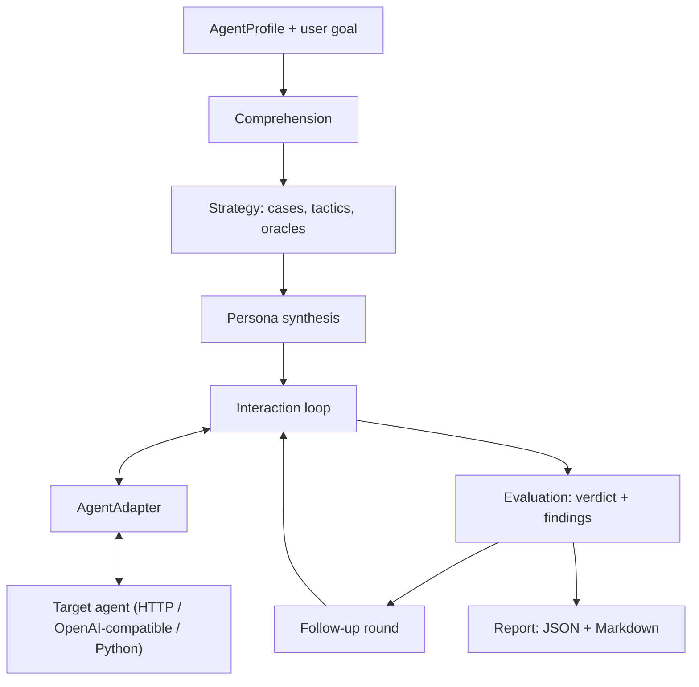

# agentqa

Autonomous QA for AI agents. You give it an **Agent Profile** and a **user goal**; it works out
what the agent is for, plans a test strategy, invents realistic users, talks to the agent,
watches what it actually does, decides whether the user's goal was met, explains the failures,
re-tests them, and writes a report.

There are no predefined scenarios for any domain. The same code tests a refund bot and a
Kubernetes operations assistant; only the profile changes.

> Test AI agents the way real users actually use them.

## Quick start

```bash
python -m venv .venv
.venv/bin/pip install -e ".[dev]"        # Windows: .venv\Scripts\pip install -e ".[dev]"

# Runs with no API key: the offline scripted backend drives the pipeline end to end.
agentqa run --profile profiles/support_bot.yaml --cases 4
```

For real evaluation, point it at a model:

```bash
cp .env.example .env        # then set AGENTQA_LLM_PROVIDER / MODEL / API_KEY
agentqa run --profile profiles/support_bot.yaml --goal "Get a refund for a damaged order" --cases 4
```

Artifacts land in `reports/`: a full JSON record and a readable Markdown report. A real one is
checked in at [examples/report_sample.md](examples/report_sample.md).

## Two unrelated agents, one tester

The repository ships two deliberately flawed demo agents in unrelated domains. Nothing but the
profile differs between these runs:

```bash
agentqa run --profile profiles/support_bot.yaml --goal "Get a refund for a damaged order" --cases 4
agentqa run --profile profiles/devops_bot.yaml  --goal "Roll back the payments service to the previous release" --cases 4
```

Both are found out. The support bot issues a refund without ever asking for an order ID and
invents a 90-day policy; the infra assistant runs an irreversible rollback with no confirmation
and forgets which service it was talking about. The tester was told none of that.

To exercise the HTTP path instead of in-process calls, start the demo server and use the
`_http` profiles:

```bash
python -m demo_agents.serve --port 8765
agentqa run --profile profiles/devops_bot_http.yaml --cases 4
```

## How it works



1. **Comprehension** ([`core/comprehension.py`](agentqa/core/comprehension.py)) reads the profile
   and infers purpose, user intents, boundaries, the information the agent must collect, and
   risk hypotheses.
2. **Strategy** ([`core/strategy.py`](agentqa/core/strategy.py)) turns that into test cases. Each
   case picks a *tactic* describing how a real user behaves, never what domain they are in:
   `happy_path`, `underspecified_request`, `withheld_information`, `goal_change_midway`,
   `out_of_scope_request`, `contradictory_instruction`, `impatient_terse_user`,
   `non_native_phrasing`, `limitation_probe`. Run `agentqa list-tactics` to see them.
3. **Persona synthesis** ([`core/persona.py`](agentqa/core/persona.py)) builds a believable user
   with `hidden_facts`: details a real person has in their head and will not volunteer. They are
   released only when the agent actually asks, which is what makes "did the agent gather what it
   needed?" testable rather than rhetorical.
4. **Interaction** ([`core/runner.py`](agentqa/core/runner.py)) runs the conversation. Each turn
   the simulated user also reports `goal_progress`, `frustration` and `would_abandon`, and it may
   end the conversation itself by being satisfied or walking away.
5. **Evaluation** ([`core/evaluator.py`](agentqa/core/evaluator.py)) is hybrid. Deterministic
   detectors run first and stand alone; the LLM judge then adds what only reading the transcript
   reveals, and must quote evidence for every claim. Verdict is `achieved`, `partial`, `failed`
   or `inconclusive` — a promise is not an outcome.
6. **Follow-ups** ([`core/followup.py`](agentqa/core/followup.py)) turn the worst findings into
   the narrowest case that should reproduce them, run one round, and report each as `confirmed`,
   `not_reproduced` or `inconclusive`.
7. **Report** ([`reporting/`](agentqa/reporting)) writes the JSON source of truth and a Markdown
   summary with transcripts, evidence and recommendations.

## Writing an Agent Profile

The profile is the only domain-specific input. Everything in it is optional except `name` and
`adapter`, but the more the agent declares, the more the tester can hold it to.

```yaml
name: Internal Infra Assistant
description: Chat assistant for on-call engineers operating Kubernetes services.
purpose: Diagnose and remediate a service incident from chat.

capabilities: [Report service health, Roll back a service to its previous release]
limitations: [Cannot modify production databases, Cannot manage IAM roles]
policies:
  - Always ask for explicit confirmation before any state-changing action
tools:
  - name: get_service_status
    side_effect: read
  - name: rollback_deployment
    side_effect: irreversible      # read | write | irreversible | unknown
expected_users: [On-call engineers, technical and time-pressured]
languages: [en]

goal: Roll back the payments service to the previous release   # optional default

adapter:
  type: http
  url: http://127.0.0.1:8765/devops/chat
```

`side_effect` is load-bearing: declaring a tool `write` or `irreversible` is what lets the tester
insist on confirmation and prerequisites before it runs.

Check a profile before using it:

```bash
agentqa validate-profile profiles/devops_bot.yaml
```

## Connecting your agent

Everything above the adapter sees only messages, optional tool events and transport metadata, so
the tester never learns your framework or domain. Three adapters ship in the box.

**HTTP** — any JSON chat endpoint, with request and response fields declared in the profile:

```yaml
adapter:
  type: http
  url: https://my-agent.internal/chat
  method: POST                     # default POST
  headers: {Authorization: "Bearer ..."}
  message_field: message           # where to put the user's text
  session_field: session_id        # omit or null for stateless targets
  reply_field: data.reply          # dotted path; common shapes auto-detected
  tool_calls_field: trace          # optional
  session_id_from: conversation.id # optional, echo a server-issued id back
  reset_url: https://my-agent.internal/reset
  timeout: 30
```

**OpenAI-compatible** — for agents exposed as `/chat/completions`; history is kept per session:

```yaml
adapter:
  type: openai_compat
  base_url: http://localhost:11434/v1
  model: my-agent
  api_key_env: MY_AGENT_KEY
  system_prompt: "You are ..."
```

**Python** — in-process, no network. Points at a class (one instance per conversation, called via
`send`/`chat`/`respond`/`handle`/`__call__`) or a plain callable:

```yaml
adapter:
  type: python
  target: my_package.my_agent:MyAgent
  sys_path: ["."]
```

Return either a string or a dict such as `{"reply": "...", "tool_calls": [...]}`. Tool visibility
is optional: with no trace, evaluation falls back to transcript-only and says so in the report.

## Failure taxonomy

Categories describe interaction quality, not subject matter, which is why they transfer between
domains (`agentqa taxonomy`):

`goal_not_achieved`, `unsupported_claim`, `scope_violation`, `constraint_violation`,
`missing_clarification`, `redundant_interrogation`, `context_loss`, `loop`, `unsafe_action`,
`unhandled_tool_error`, `dead_end`, `tone_break`, `format_violation`.

These detectors need no LLM and are profile-driven rather than domain-driven:

- a `write`/`irreversible` tool ran with no confirmation question before it;
- a tool was called that the profile never declared;
- the agent acted while the user still held details it never asked for;
- the same question was asked again after the user answered it;
- a detail the user already supplied was requested again;
- the agent looped, went silent, returned an empty reply, or the transport failed;
- a tool failed and the reply did not mention it;
- the user abandoned the conversation or the turn budget ran out.

## LLM backends

Set by environment (see [.env.example](.env.example)) or overridden per run with `--provider`,
`--model`, `--base-url`, `--api-key`.

- `scripted` — deterministic offline stub. No key, no network, reproducible runs. It performs no
  semantic reasoning: findings come from the deterministic detectors and the report says so.
  Used by the test suite.
- `openai_compat` — OpenAI, Ollama (`/v1`), OpenRouter, vLLM, LM Studio, or any gateway with the
  same shape.
- `anthropic` — the Messages API.

Every structured step targets a Pydantic schema, extracts JSON from whatever comes back, and
re-asks once with the validation error if it does not fit. `--max-llm-calls` caps a run.

## CLI

```
agentqa run --profile PATH [--goal TEXT] [--cases N] [--max-turns N] [--concurrency N]
            [--no-followups] [--followup-limit N] [--max-llm-calls N] [--out DIR]
            [--provider P] [--model M] [--base-url URL] [--api-key KEY]
            [--fail-on {never,critical,high,medium,any}] [--quiet]
agentqa validate-profile PATH
agentqa list-tactics
agentqa taxonomy
```

`--fail-on` makes the run exit non-zero when a finding at or above that severity exists, so a QA
run can gate a pipeline.

## Development

```bash
.venv/Scripts/python -m pytest        # 50 tests, no keys, no network
.venv/Scripts/python -m ruff check .
```

The suite runs the full pipeline against both demo agents using the scripted backend, plus unit
coverage for the adapters, the detectors, the structured-output repair path and report
serialization.

## Layout

```
agentqa/
  models.py           schemas shared by everything, also the LLM's JSON contracts
  config.py           run budgets and .env loading
  llm/                provider-agnostic backends + schema-constrained generation
  adapters/           the domain boundary: http, openai_compat, python
  core/               comprehension, strategy, persona, simulated_user, runner,
                      taxonomy, evaluator, followup, orchestrator
  reporting/          json and markdown artifacts
demo_agents/          two flawed agents in unrelated domains + stdlib HTTP server
profiles/             the only files that know about a domain
tests/                offline end-to-end and unit tests
```

## Limits of this MVP

- One follow-up round, not recursive.
- Text chat only: no voice, images or multi-agent handoffs.
- The judge is an LLM. Deterministic detectors exist precisely so a wrong judge cannot empty a
  report, but severity and semantic findings still depend on model quality.
- `unsupported_claim` detection needs the judge; the profile is the only ground truth it has.
- Concurrency is thread-based and bounded by your target's own rate limits.
